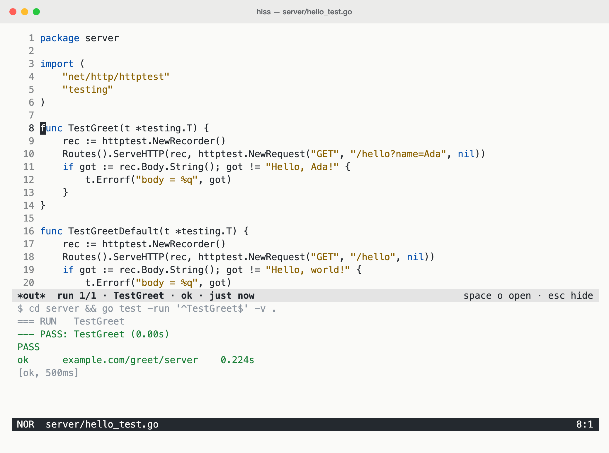

# hiss

A small modal terminal editor for reviewing edits, exploring code, and running
queries, requests, and tests alongside Claude Code.

Work in hiss with Claude Code next to it. Routine edits apply and save as Claude
works, with marks in the gutter. Changes that need your attention wait for inline
review: accept, reject, edit the proposed lines, or comment and let Claude revise.
You can require review for specific files and undo a turn's applied edits.

The conversation stays close to the code. Follow Claude's walkthroughs, discuss
individual lines, and answer its questions in the editor. Press `enter` to run a
test, SQL query, HTTP request, or script and see the output below the code. Pick
the environment, choose which results Claude sees, and keep useful runs as files.
You can also review GitHub PRs together and send your comments as one review.

Editing follows Helix and Kakoune: select first, then act. Language servers on
your PATH provide diagnostics and navigation for Go, Rust, TypeScript, Python,
C, Zig, Solidity, and more—even for lines still waiting for review.

## Get started

Requires Go 1.27 or later. PR review needs [`gh`](https://cli.github.com),
signed in; language servers are used when they're on your PATH.

```sh
go install github.com/synthlike/hiss/cmd/hiss@latest
claude mcp add --scope user hiss -- hiss mcp
hiss setup --write   # in your project: adds hiss to .claude/settings.json
```

The settings route Claude's edits through hiss (they deny its built-in Edit and
Write tools) and add hooks so hiss knows what Claude is doing; `hiss setup`
without `--write` prints them for you to check first. Shell commands can still
write files, so this is a convention, not a sandbox.

Then run `hiss` in your project and Claude Code next to it, in either order.

## In action

Review a change set hunk by hunk, and discuss it inline.

<picture>
  <source media="(prefers-color-scheme: dark)" srcset="docs/screenshots/review-dark.png">
  
</picture>

Ask Claude to walk you through code: it shares a trail of steps anchored to the
lines, and you discuss each step with it in place.

<picture>
  <source media="(prefers-color-scheme: dark)" srcset="docs/screenshots/code-tour-dark.png">
  
</picture>

Send the HTTP request under the cursor with `enter`, in the environment you
pick; environments configured with `confirm = true` ask first.

<picture>
  <source media="(prefers-color-scheme: dark)" srcset="docs/screenshots/run-http-dark.png">
  
</picture>

Run a SQL query against the active environment's database. Share the result
with Claude so it can help interpret the output or revise the query.

<picture>
  <source media="(prefers-color-scheme: dark)" srcset="docs/screenshots/run-sql-dark.png">
  
</picture>

Run the test under the cursor with `enter` and read its output below the code.
Test results are shared with Claude by default.

<picture>
  <source media="(prefers-color-scheme: dark)" srcset="docs/screenshots/run-test-dark.png">
  
</picture>

Answer Claude's questions without leaving the editor.

<picture>
  <source media="(prefers-color-scheme: dark)" srcset="docs/screenshots/ask-dark.png">
  
</picture>

Find the change you want to review with the fuzzy hunk picker (`space h`).

<picture>
  <source media="(prefers-color-scheme: dark)" srcset="docs/screenshots/fuzzy-finder-dark.png">
  
</picture>

Click a screenshot for full size.

## Editing and review

Routine edits save immediately. `space g` lists what Claude changed, and `:su`
undoes a turn's applied changes. Claude asks for review for changes such as auth,
deletions, migrations, and public APIs. Edits also wait when a file has your
unsaved changes, is outside the project, or matches a `[review]` rule in
`.hissrun`. Changes to `.hissrun` itself always wait.

Pending hunks show old lines in red and proposed lines in green. `+` accepts and
saves; `-` rejects with an optional reason. Edit the green lines before accepting,
or use `#` to discuss a hunk. The language server checks the proposed code before
you accept it. Pending hunks and their discussions survive a restart.

To review changes already on disk, ask Claude or use `:review`: uncommitted
changes, the last commit, or a revision or range. Accept, reject (which reverts
the hunk), or comment as you go. For a GitHub PR, `:pr 123` checks it out on a
clean tree. There, `+` marks a hunk viewed and `-` flags it. Draft GitHub comments
with `:gc <text>`, accept Claude's drafts with `:gca`, and send them together with
`:prs [approve|changes] [text]`. hiss asks before sending. `:prd` returns to your
previous branch.

## Running tests, queries, and requests

Press `enter` on a Go or Foundry test to run it. For queries, requests, and
scripts, add rules to `.hissrun` in the project root:

```ini
[sql]
match = *.sql
cmd   = psql "$DATABASE_URL" -X -f -
share = true

[http]
match = *.http
cmd   = sh
```

Put a SQL query in a `.sql` file or a curl command in a `.http` file, then press
`enter` on it. The paragraph under the cursor—or your selection—goes to the
command's stdin. Output streams into a panel below the text. `C-c` cancels;
`:rerun` runs the last shown run again.

Use `:env` to choose an environment defined in `.hissrun`, with its own setup
script and optional confirmation before running. Keep useful queries and
requests in `.hiss/runs/` and find them with `space r`.

Test results are shared with Claude by default; custom rules share output when
`share = true`. Claude can also propose a query or request that runs when you
accept its hunk. See the [running guide](docs/guide.md#running) for environments,
saved runs, and more rule examples.

## Finding your way

Ask Claude to “walk me through the auth flow” for a trail of steps anchored to
lines of code. Follow it with `]s` and discuss a step with `#`.

| Keys | Action |
| --- | --- |
| `]h` / `[h` | next / previous pending hunk |
| `+` / `-` / `#` | accept / reject / comment |
| `]s` / `[s` | next / previous trail step |
| `enter` | run what's under the cursor |
| `space f` `b` `h` `t` `r` | pick a file, buffer, hunk, trail step or saved run |
| `:pr <n>` / `:prs` | review GitHub PR n / send your review |

The [guide](docs/guide.md) covers the rest: editing, PR review, language
servers, run output and `.hissrun` with environments.

## Status

Early and small. Claude Code has the full integration: setup, status updates,
and hooks that wake it when you comment. Other agents can use hiss's MCP tools,
without the status updates and wake-ups provided by those hooks.

## License

MIT, see [LICENSE](LICENSE).
