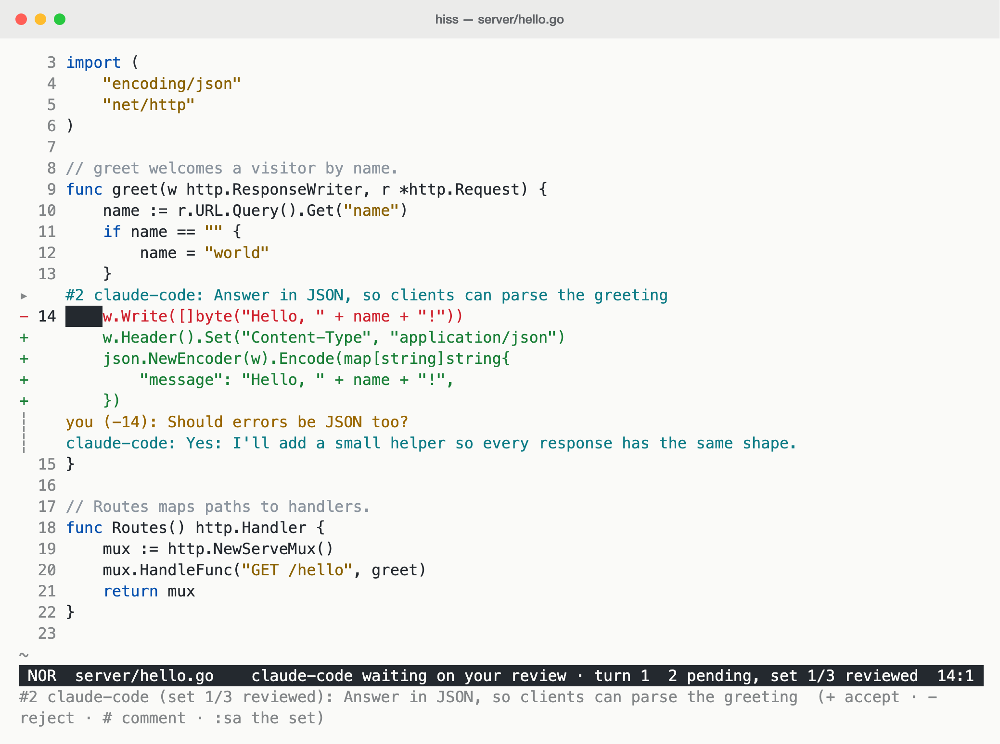
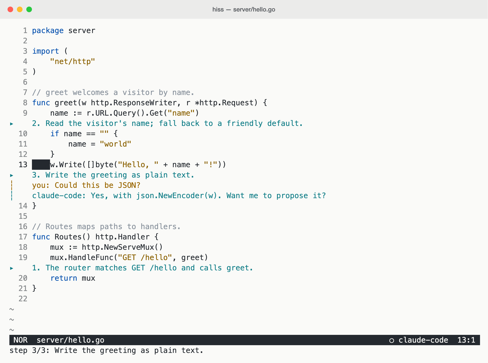
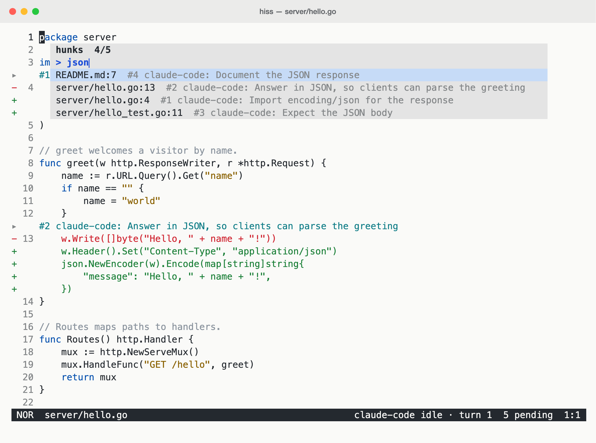

# hiss

A small modal terminal editor for working alongside Claude Code.

Claude doesn't write your files: it proposes edits, and you review them inline,
accept or reject each one, tweak it before accepting, or comment and let Claude
revise. Navigation is inspired by Helix.

## In action

Review proposed changes and discuss them inline.

<picture>
  <source media="(prefers-color-scheme: dark)" srcset="docs/screenshots/review-dark.png">
  <source media="(prefers-color-scheme: light)" srcset="docs/screenshots/review-light.png">
  
</picture>

Follow a guided code tour, with notes anchored to the relevant lines.

<picture>
  <source media="(prefers-color-scheme: dark)" srcset="docs/screenshots/code-tour-dark.png">
  <source media="(prefers-color-scheme: light)" srcset="docs/screenshots/code-tour-light.png">
  
</picture>

Find the change you want to review with the fuzzy hunk picker (`space h`).

<picture>
  <source media="(prefers-color-scheme: dark)" srcset="docs/screenshots/fuzzy-finder-dark.png">
  <source media="(prefers-color-scheme: light)" srcset="docs/screenshots/fuzzy-finder-light.png">
  
</picture>

## Install

Requires Go 1.27 or later.

```sh
go install github.com/synthlike/hiss/cmd/hiss@latest
```

## Set up Claude Code

```sh
claude mcp add --scope user hiss -- hiss mcp
hiss setup --write   # in your project: adds hiss to .claude/settings.json
```

The settings route Claude's edits through hiss (they deny its built-in Edit and
Write tools) and add hooks so hiss knows what Claude is doing. Shell commands can
still write files, so this is a convention, not a sandbox.

Then run `hiss` in your project and Claude Code next to it, in either order.

## Working with Claude

- **Ask for a change.** It appears as a pending hunk: old lines in red, proposed
  lines in green, Claude's reason above. `]h` takes you to it.
- **Review it.** `+` accepts and saves. `-` rejects, asking for an optional reason
  to tell Claude.
- **Tweak it.** Edit the green lines, then `+`. Claude is told what you changed.
- **See what it breaks.** In Go files, gopls checks the code as if the pending
  hunks were accepted: problems in a hunk show on its green lines, ones it
  causes elsewhere on those lines. Claude can check its own with get_diagnostics.
- **Discuss it.** `#` comments on the hunk or the line under the cursor; Claude
  replies inline or sends a revision, even after its turn has ended.
- **Get a tour.** Ask "walk me through the auth flow": Claude shares a trail of
  steps with notes, which you follow with `]s` and can comment on.
- **Point at code.** Select something in hiss, then ask Claude about "this"
  ("what does this do?"): it can read your selection.

| Keys | |
| --- | --- |
| `]h` / `[h` | next / previous pending hunk |
| `+` / `-` / `#` | accept / reject / comment |
| `]s` / `[s` | next / previous trail step |
| `space f` `b` `h` `t` | pick a file, buffer, hunk or trail step |
| `:haa` / `:hra` | accept / reject all hunks |

## Editing

- `/` searches as you type, `n` / `N` repeat, `*` searches for the selection.
- `:<line>` goes to a line; `C-o` / `C-i` jump back and forward.
- `:` shows the commands as you type; `tab` completes them.
- `:note <text>` (`:n`) adds a line to `.hiss/notes.md` with the date, the
  commit (`+` if the file has changed since) and the cursor's `path:line`;
  `space n` lists the notes, newest first.
- In Go files, gopls's diagnostics are marked in the gutter and underlined; the
  cursor line's message shows below, and `]d` / `[d` go to the next / previous.
  `gd` goes to a definition and `gr` lists references, also from proposed lines;
  `space s` lists the file's symbols.
  Resting the cursor on a name highlights its other uses; on `func` or
  `return`, the function's returns.
- In a Go test, `enter` runs it with `go test -run` on the files as saved and
  streams the output into `*out*`; `enter` on a `file:line` there goes to it.
  `C-c` cancels, and `:rerun` (`:rr`) runs it again from anywhere.
- `.hissrun` at the project root tells `enter` what to run in other files. The
  paragraph under the cursor (or the selection, or with `input = file` the
  whole file) goes to the command's stdin; with `find`, a regexp searched
  upward from the cursor gives the command `$1`…. Commands run with `sh -c` in
  the project root, with `$file`, `$dir`, `$line` and `$root` set. In
  Markdown, a fenced block runs with the rule for its language.

  ```ini
  [sql]
  match = *.sql
  cmd   = psql "$DATABASE_URL" -X -f -

  # requests.http holds curl commands; secrets stay in your shell's env
  [http]
  match = *.http
  cmd   = sh
  ```

  Queries and requests worth keeping go in `.hiss/runs/`; `space r` lists the
  ones a rule matches.
- Colours follow your terminal's light or dark background; `HISS_THEME=light` or
  `dark` overrides.

## Status

v0.2: early and small, now with gopls diagnostics and navigation. Next up
(v0.3): run the SQL query, HTTP request or Go test under the cursor.

## License

MIT, see [LICENSE](LICENSE).
