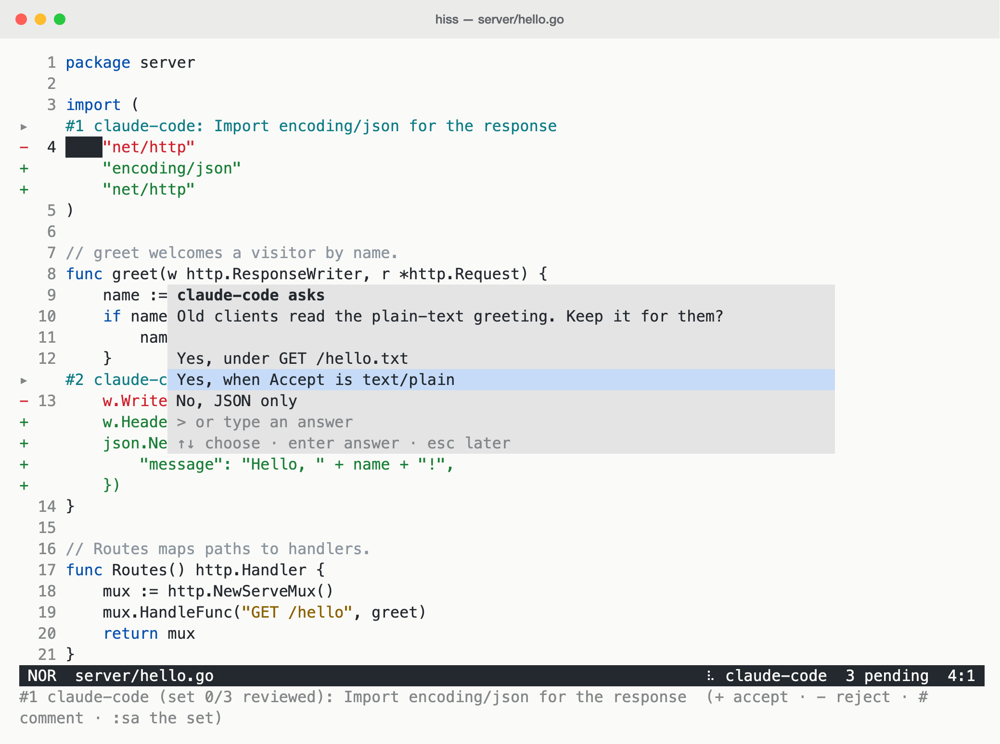
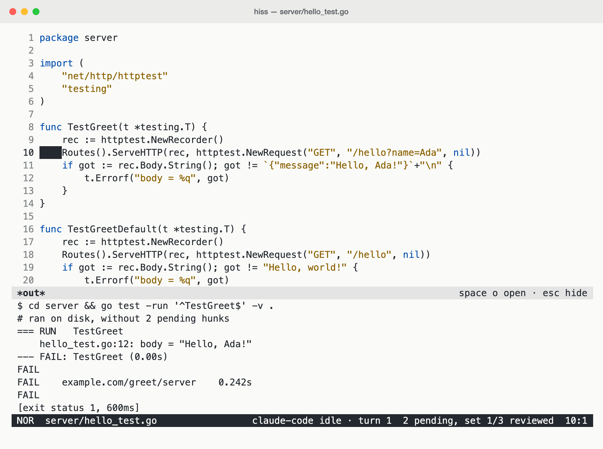

# hiss

A small modal terminal editor for working alongside Claude Code.

Claude doesn't write your files. It proposes edits, which you review inline:
accept or reject each one, tweak it before accepting, or comment and let Claude
revise.

The rest of the loop happens in the editor too. Claude walks you through code
and asks you questions there; you run tests, SQL queries and HTTP requests with
`enter`, in the environment you pick, and Claude sees how they went. Go files
get gopls diagnostics and navigation, proposed lines included. Editing is
inspired by Helix and Kakoune: select first, then act.

## In action

Review a change set hunk by hunk, and discuss it inline.

<a href="docs/screenshots/review-light.png"><picture>
  <source media="(prefers-color-scheme: dark)" srcset="docs/screenshots/review-dark.png">
  <source media="(prefers-color-scheme: light)" srcset="docs/screenshots/review-light.png">
  
</picture></a>

Follow a guided code tour, with notes anchored to the relevant lines.

<a href="docs/screenshots/code-tour-light.png"><picture>
  <source media="(prefers-color-scheme: dark)" srcset="docs/screenshots/code-tour-dark.png">
  <source media="(prefers-color-scheme: light)" srcset="docs/screenshots/code-tour-light.png">
  
</picture></a>

Answer Claude's questions without leaving the editor.

<a href="docs/screenshots/ask-light.png"><picture>
  <source media="(prefers-color-scheme: dark)" srcset="docs/screenshots/ask-dark.png">
  <source media="(prefers-color-scheme: light)" srcset="docs/screenshots/ask-light.png">
  
</picture></a>

Run the test under the cursor with `enter`; Claude sees the result too.

<a href="docs/screenshots/run-light.png"><picture>
  <source media="(prefers-color-scheme: dark)" srcset="docs/screenshots/run-dark.png">
  <source media="(prefers-color-scheme: light)" srcset="docs/screenshots/run-light.png">
  
</picture></a>

Find the change you want to review with the fuzzy hunk picker (`space h`).

<a href="docs/screenshots/fuzzy-finder-light.png"><picture>
  <source media="(prefers-color-scheme: dark)" srcset="docs/screenshots/fuzzy-finder-dark.png">
  <source media="(prefers-color-scheme: light)" srcset="docs/screenshots/fuzzy-finder-light.png">
  
</picture></a>

Click a screenshot for full size. `docs/screenshots/shoot.sh` regenerates them from the real UI.

## Get started

Requires Go 1.27 or later.

```sh
go install github.com/synthlike/hiss/cmd/hiss@latest
claude mcp add --scope user hiss -- hiss mcp
hiss setup --write   # in your project: adds hiss to .claude/settings.json
```

The settings route Claude's edits through hiss (they deny its built-in Edit and
Write tools) and add hooks so hiss knows what Claude is doing. Shell commands can
still write files, so this is a convention, not a sandbox.

Then run `hiss` in your project and Claude Code next to it, in either order.

## How it works

- **Review.** Claude's edits arrive as pending hunks. `+` accepts and saves, `-`
  rejects with an optional reason, and you can edit the green lines first. A
  turn's hunks form a change set you can take or leave whole.
- **Discuss.** `#` comments on a hunk or line; Claude replies inline or sends a
  revision, even after its turn has ended.
- **Check.** In Go, gopls checks the code as if the pending hunks were
  accepted, and Claude can vet and test its proposals before you see them.
- **Tour.** Ask "walk me through the auth flow" and follow Claude's notes step
  by step.
- **Run.** `enter` runs the Go test, SQL query or HTTP request under the
  cursor, in the environment you pick; `.hissrun` says how. Claude can see the
  result, and propose a query that runs when you accept it.
- **Resume.** Pending hunks and their threads survive a crash or restart.

| Keys | |
| --- | --- |
| `]h` / `[h` | next / previous pending hunk |
| `+` / `-` / `#` | accept / reject / comment |
| `]s` / `[s` | next / previous tour step |
| `enter` | run what's under the cursor |
| `space f` `b` `h` `t` | pick a file, buffer, hunk or tour step |

The [guide](docs/guide.md) covers the rest: editing, gopls, run output and
`.hissrun` with environments.

## Status

v0.5: early and small. Runs get environments (with a confirm for the risky
ones), `enter` runs the table case or subtest under the cursor, the last 20
runs' output stays at hand, and Claude can propose a query that runs when you
accept it. Since v0.4, an agent turn's proposals are reviewed as one change
set, and agents can vet and test them before you do.

## License

MIT, see [LICENSE](LICENSE).
