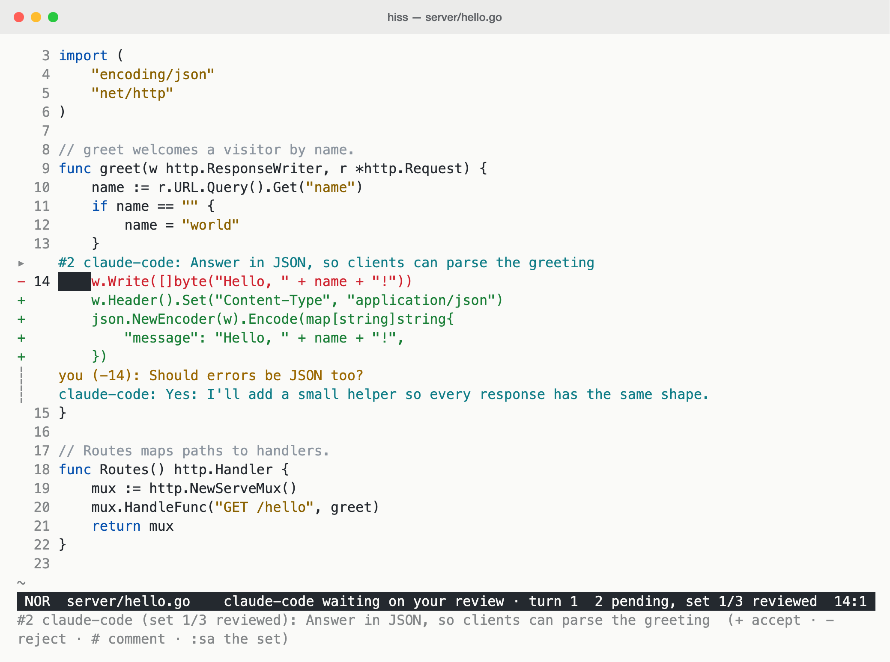
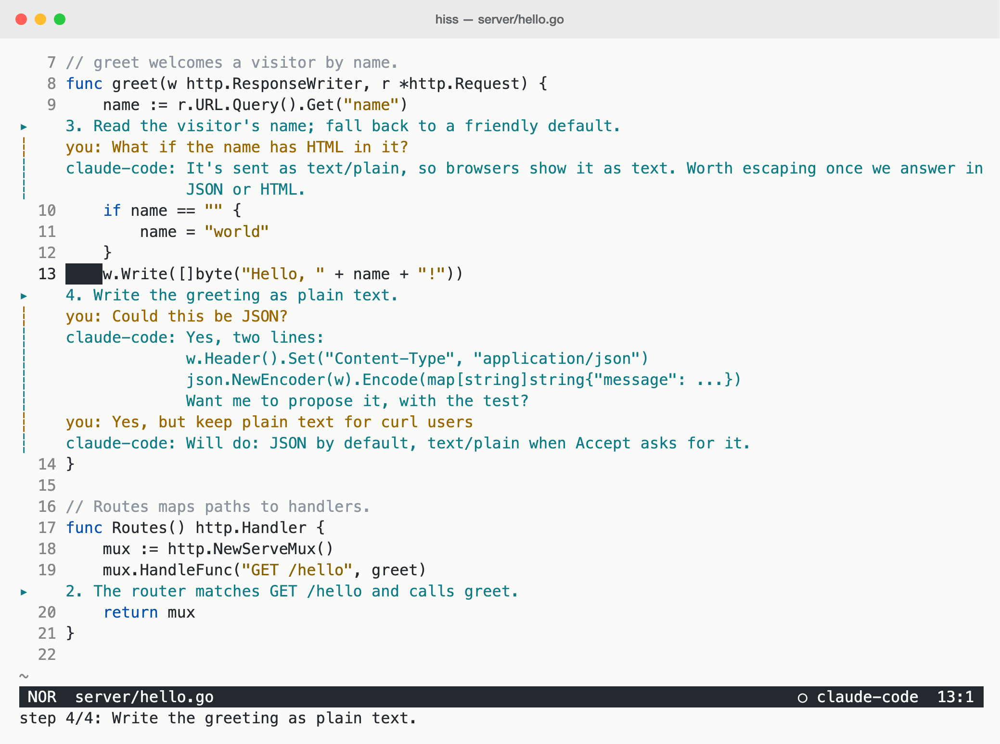
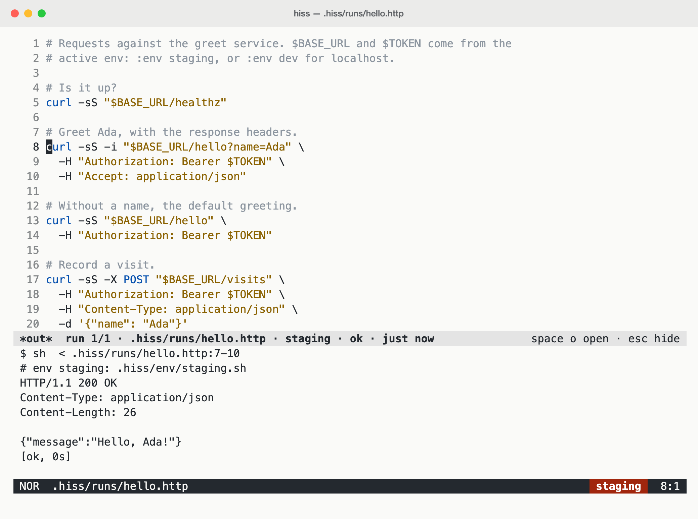
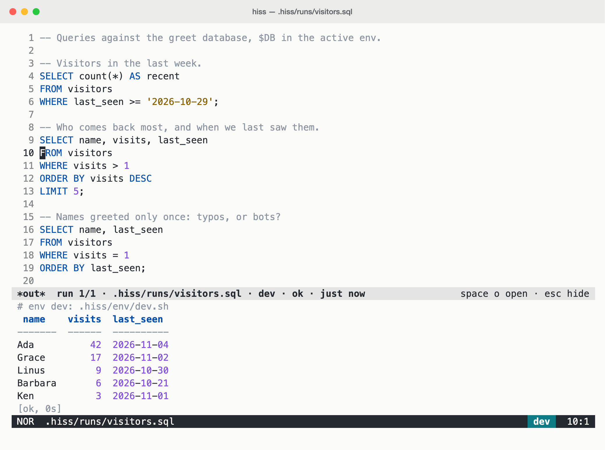
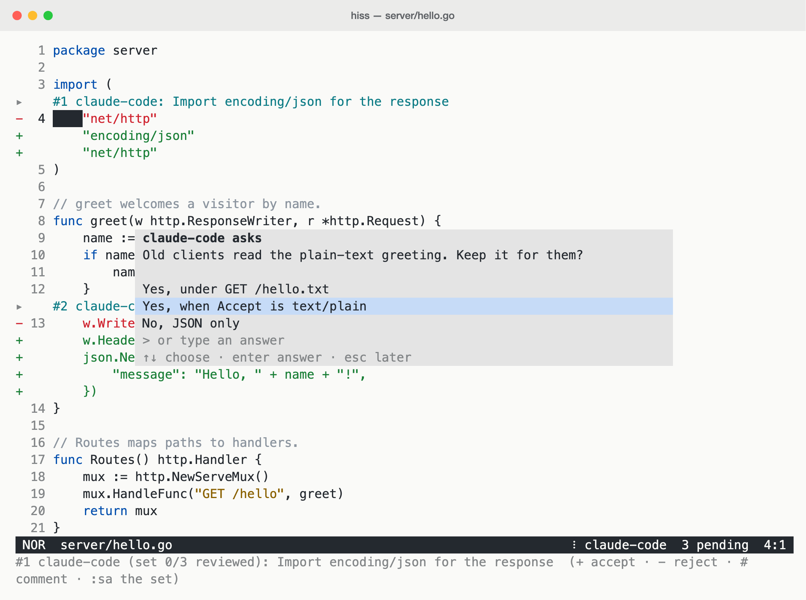
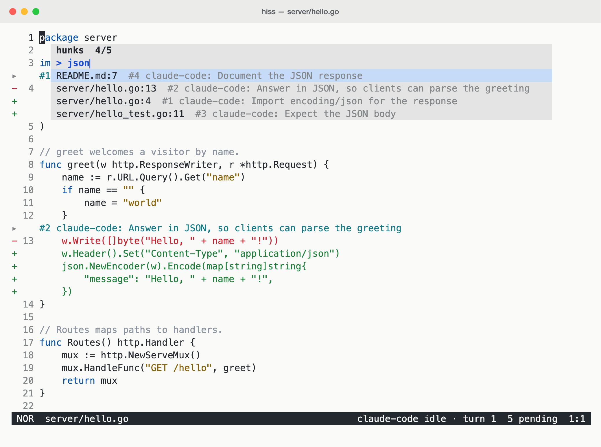

# hiss

A small modal terminal editor for working alongside Claude Code.

Claude's edits land in your files as it works, and you see them in the gutter.
When something deserves a look, Claude asks for your review: accept or reject
inline, tweak before accepting, or comment and let Claude revise. Files you name
always wait for review, and you can undo a whole turn.

The rest of the loop happens in the editor too. Claude walks you through code
and asks you questions there; you run tests, SQL queries and HTTP requests with
`enter`, in the environment you pick, and Claude sees how they went. Go, Rust,
TypeScript, Python, C, Zig, Solidity and a few more get diagnostics and
navigation from their language server when it's on your PATH, proposed lines
included. Editing is inspired by Helix and Kakoune: select first, then act.

## In action

Review a change set hunk by hunk, and discuss it inline.

<a href="docs/screenshots/review-light.png"><picture>
  <source media="(prefers-color-scheme: dark)" srcset="docs/screenshots/review-dark.png">
  <source media="(prefers-color-scheme: light)" srcset="docs/screenshots/review-light.png">
  
</picture></a>

Ask Claude to walk you through code: it shares a trail of steps anchored to the
lines, and you discuss each step with it in place.

<a href="docs/screenshots/code-tour-light.png"><picture>
  <source media="(prefers-color-scheme: dark)" srcset="docs/screenshots/code-tour-dark.png">
  <source media="(prefers-color-scheme: light)" srcset="docs/screenshots/code-tour-light.png">
  
</picture></a>

Send the HTTP request under the cursor with `enter`, in the environment you
pick; staging asks first.

<a href="docs/screenshots/run-http-light.png"><picture>
  <source media="(prefers-color-scheme: dark)" srcset="docs/screenshots/run-http-dark.png">
  <source media="(prefers-color-scheme: light)" srcset="docs/screenshots/run-http-light.png">
  
</picture></a>

Run a SQL query the same way, against the active env's database; tests and
scripts too. Claude sees the result when the rule shares it.

<a href="docs/screenshots/run-sql-light.png"><picture>
  <source media="(prefers-color-scheme: dark)" srcset="docs/screenshots/run-sql-dark.png">
  <source media="(prefers-color-scheme: light)" srcset="docs/screenshots/run-sql-light.png">
  
</picture></a>

Answer Claude's questions without leaving the editor.

<a href="docs/screenshots/ask-light.png"><picture>
  <source media="(prefers-color-scheme: dark)" srcset="docs/screenshots/ask-dark.png">
  <source media="(prefers-color-scheme: light)" srcset="docs/screenshots/ask-light.png">
  
</picture></a>

Find the change you want to review with the fuzzy hunk picker (`space h`).

<a href="docs/screenshots/fuzzy-finder-light.png"><picture>
  <source media="(prefers-color-scheme: dark)" srcset="docs/screenshots/fuzzy-finder-dark.png">
  <source media="(prefers-color-scheme: light)" srcset="docs/screenshots/fuzzy-finder-light.png">
  
</picture></a>

Click a screenshot for full size. `docs/screenshots/shoot.sh` regenerates them from the real UI.

## Get started

Requires Go 1.27 or later.

```sh
go install github.com/synthlike/hiss/cmd/hiss@latest
claude mcp add --scope user hiss -- hiss mcp
hiss setup --write   # in your project: adds hiss to .claude/settings.json
```

The settings route Claude's edits through hiss (they deny its built-in Edit and
Write tools) and add hooks so hiss knows what Claude is doing. Shell commands can
still write files, so this is a convention, not a sandbox.

Then run `hiss` in your project and Claude Code next to it, in either order.

## How it works

- **Edits land.** Claude's routine edits apply and save right away, marked in
  the gutter. `space g` lists them and `:su` undoes a turn's.
- **Review when it matters.** Claude holds back what you should look at: auth,
  deletions, migrations, real choices. Those arrive as pending hunks, as do
  edits to `[review]` files in `.hissrun` and to files with your unsaved
  changes. `+` accepts and saves, `-` rejects with an optional reason, and you
  can edit the green lines first. A turn's hunks form a change set you can take
  or leave whole.
- **Review what landed.** Claude sends you a change hunk by hunk, like a trail,
  or `:review` starts one. Accept, reject (which reverts the hunk) or comment as
  you go, Claude answers in real time, and `:rf` finishes early. `:pr 123`
  checks out a GitHub PR (with `gh`, on a clean tree) and walks it the same
  way, except `+` marks a hunk viewed and `-` flags it without touching the
  code. `:gc <text>` drafts a comment for GitHub on the line or selected lines
  (kept in `.hiss/pr/`); Claude's drafts wait for `:gca`. `:prs [approve|changes]
  [text]` sends them as one review after asking; `:prd` goes back.
- **Discuss.** `#` comments on a hunk or line; Claude replies inline or sends a
  revision, even after its turn has ended.
- **Check.** The language server checks the code as if the pending hunks were
  accepted; in Go, Claude can also vet and test them before you see them.
- **Tour.** Ask "walk me through the auth flow" and follow Claude's notes step
  by step.
- **Run.** `enter` runs the Go or Foundry test, SQL query or HTTP request under
  the cursor, in the environment you pick; `.hissrun` says how. Claude can see
  the result, and propose a query that runs when you accept it.
- **Resume.** Pending hunks and their threads survive a crash or restart.

| Keys | |
| --- | --- |
| `]h` / `[h` | next / previous pending hunk |
| `+` / `-` / `#` | accept / reject / comment |
| `]s` / `[s` | next / previous tour step |
| `enter` | run what's under the cursor |
| `space f` `b` `h` `t` | pick a file, buffer, hunk or tour step |

The [guide](docs/guide.md) covers the rest: editing, language servers, run
output and `.hissrun` with environments.

## Status

v0.7: early and small. You can now review GitHub PRs in hiss: `:pr` checks one
out and walks its hunks, you and Claude draft comments on its lines, and
`:prs` sends them as one review. Since v0.6, Claude's edits land as it works
and it asks for review where it matters; language servers come from a
built-in table, with no config.

## License

MIT, see [LICENSE](LICENSE).
